# Odyssey-3 (2025) HF + 6 m SDR transceiver

**A 50 W, single-board, direct-sampling SDR transceiver for 160–6 m by David Fainitski, N7DDC.**
It works with **Thetis** and other openHPSDR **Protocol 2** programs over Gigabit Ethernet.

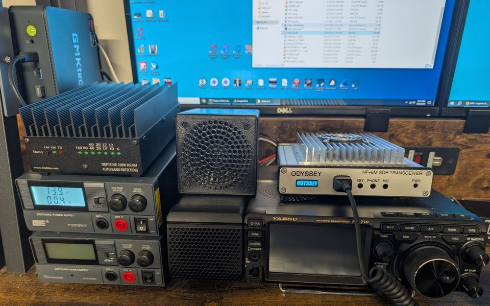

  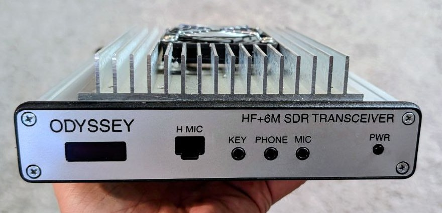
  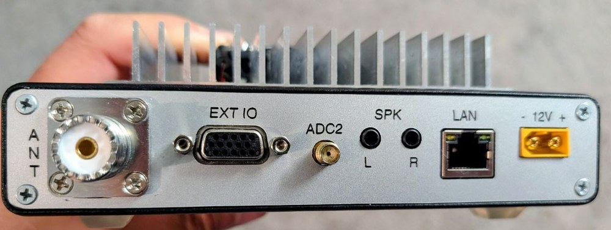

---

## Features

**Radio**
- 160–6 m, **50 W** output, power amplifier on the same board
- Two 16-bit **LTC2165** ADCs at 122.88 MHz; the second ADC has its own **ADC2** input on the rear panel
- Low-noise preamp (MGA-53543) and two digital step attenuators (DAT-31)
- 14-bit **AD9744** DAC for transmit
- 7 band-pass and 7 low-pass filters (160, 80, 60/40, 30/20, 17/15, 12/10, 6 m), switched automatically by frequency
- 122.88 MHz master clock locked to a 10 MHz reference; external 10 MHz input on EXT IO pin 5

**Computer link and firmware**
- openHPSDR Protocol 2, Angelia-compatible: 4 independent receivers, PureSignal and Diversity support in Thetis
- Gigabit Ethernet (KSZ9031); static IP or DHCP
- **Bootloader 3.3**: three firmware slots and self-update over the network, see [below](#updating-the-firmware-bootloader-33)

**Audio and connections**
- TLV320AIC23B audio codec
- Front panel: Yaesu-compatible hand-mic socket, MIC, PHONE and KEY jacks
- Rear panel: SPK L/R speaker outputs with a built-in amplifier, and a 15-pin **EXT IO** connector, see [EXT IO](#ext-io-connector)

**Front-panel controller (PIC MCU)**
- OLED display and power button
- Display screens: logo, firmware/IP/slot, power and SWR meter, temperature
- Fan control in 3 speeds, **overheat** and **high-SWR** protection
- Hand-mic button handling

  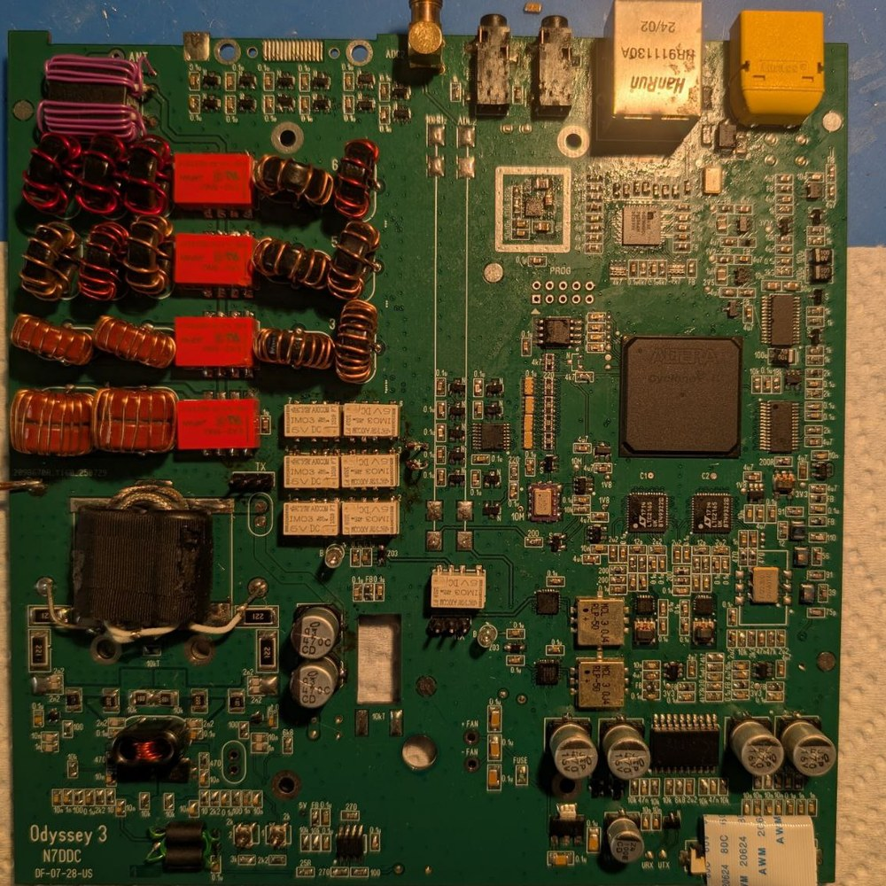

  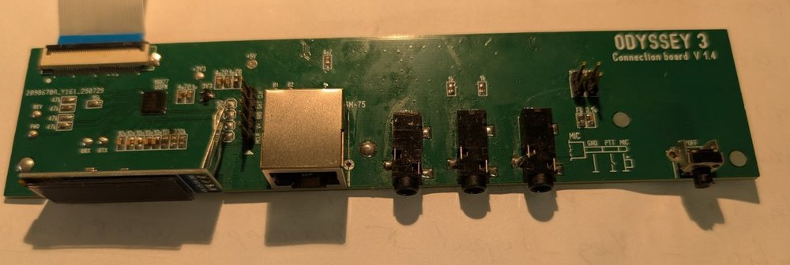

---

## Panels

| Front | Rear |
|---|---|
| **OLED** display | **ANT**: SO-239 antenna connector |
| **H MIC**: RJ-45 for a Yaesu-type hand microphone (SSM-75) | **EXT IO**: 15-pin connector, see [below](#ext-io-connector) |
| **KEY**: paddle or straight key | **ADC2**: SMA input of the second ADC |
| **PHONE**: headphones | **SPK L / R**: speaker outputs |
| **MIC**: microphone | **LAN**: Gigabit Ethernet |
| **PWR**: power button | **12V**: XT60 power input, 13.8 V |

### EXT IO connector

DB-15HD (VGA-type) female connector on the rear panel.

| Pin | Signal | Pin | Signal | Pin | Signal |
|---|---|---|---|---|---|
| 1 | UO7 | 6 | ANT_1 | 11 | GND |
| 2 | TUNE | 7 | UO6 | 12 | UO5 |
| 3 | PTT_OUT | 8 | ANT_2 | 13 | ANT_3 |
| 4 | UO4 | 9 | PTT_IN | 14 | UO2 |
| 5 | 10MHz_in | 10 | UO1 | 15 | UO3 |

- **UO1–UO7**: user outputs. Set them per band in the Thetis open-collector (OC) settings, for example to switch an amplifier or antenna.
- **ANT_1–ANT_3**: antenna selection outputs, set by Thetis.
- **PTT_OUT**: open-collector output, active low (pulled to GND while transmitting), up to 12 V; use it to key an amplifier.
- **PTT_IN**: transmit input, for example a foot switch. Connect it to GND to transmit.
- **TUNE**: tune output.
- **10MHz_in**: external 10 MHz reference input.

---

## Power button

- **Hold PWR for about 2 seconds** to switch the radio on or off.
- The radio remembers its state. If it was on when 12 V was removed, it switches on by itself when 12 V comes back.

The OLED shows *DESIGNED BY N7DDC / FW VERSION x.x* during start-up. It then shows the firmware version, IP address and slot for 3 seconds.

---

## Hand microphone (Yaesu SSM-75)

  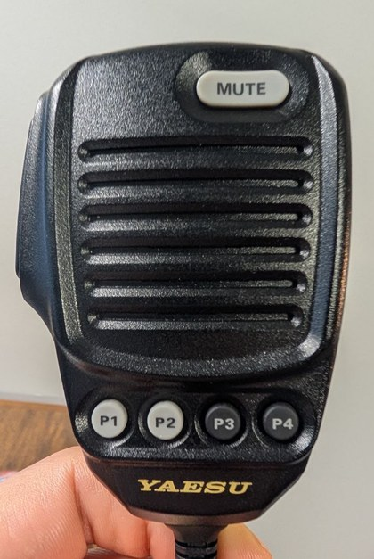
  &nbsp;&nbsp;
  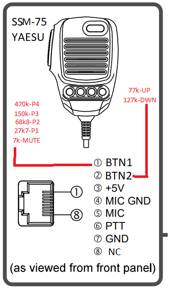

### Normal operation

| Button | Function |
|---|---|
| **PTT** | Transmit |
| **MUTE** | Mute or unmute the built-in speaker amplifier (SPK outputs only). The OLED shows *MUTE* or *UNMUTE*. The setting is saved. |
| **P1 – P4** | Choose the display screen, see below |
| **UP / DWN** | Not used in normal operation; they select the slot in bootloader mode |

| P1: logo | P2: firmware, IP, boot slot |
|---|---|
| 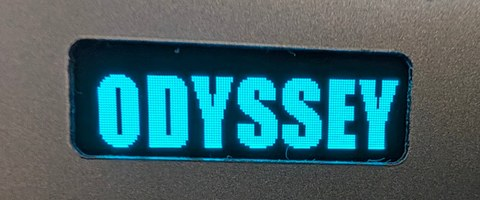 | 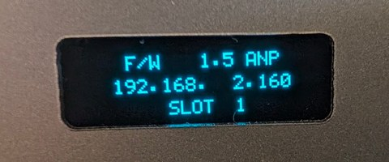 |
| **P3: output power and SWR** | **P4: temperature and fan speed** |
| 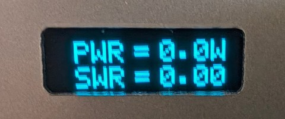 | 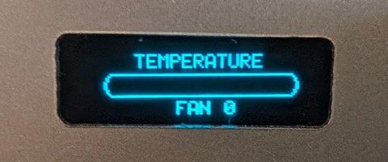 |

The selected screen is saved and comes back after the next power-on.

### Held while switching on

Hold the button while switching the radio on (PWR, or 12 V when the radio was left on), then release it.

| Hold | Result |
|---|---|
| **UP** or **DWN** | Start in **bootloader mode** |
| **P3** | **IP reset**: IP becomes 0.0.0.0, so the firmware gets its address by **DHCP**. Also starts in bootloader mode. |
| **P4** | **IP restore**: the default static IP **192.168.2.160**. Also starts in bootloader mode. |

### In bootloader mode

| Button | Function |
|---|---|
| **UP / DWN** | Choose the slot the radio boots from, **1–3** (saved) |
| **MUTE** | Leave the bootloader and start the firmware in the chosen slot |
| **PWR** (hold) | Switch off |

If the button resistors of your microphone differ, the values are in the pinout picture: BTN1 = 7k, 27k7, 68k8, 150k, 470k (MUTE, P1–P4); BTN2 = 77k (UP), 127k (DWN).

---

## Protections

| OLED message | What happens |
|---|---|
| **OVERHEAT** | The PA bias is switched off until the heatsink cools down. The fan runs at 3 speeds according to temperature. |
| **HIGH SWR** | At 15 W or more with SWR above 3.0, transmit is blocked until the SWR is back to normal. |
| **FPGA ERROR** | The FPGA did not answer: firmware missing or damaged in the selected slot. Hold PWR to switch off, then start in bootloader mode and choose another slot or write the firmware again. |

---

## Network

- The bootloader always works with a **static IP**; the default is **192.168.2.160**.
- The working firmware uses the same static IP. If the IP is **0.0.0.0** (hold P3 at power-on), it uses **DHCP**.
- With a static IP, the PC network card must be in the same subnet, for example 192.168.2.10 / 255.255.255.0.
- The link runs at **1 Gbit/s**. If the radio is not found, first check that the PC network card is in 1000 Mbit mode.
- In Thetis, select the radio model **ANAN-100D** (the board reports itself as Angelia).

---

## Updating the firmware (Bootloader 3.3)

The flash memory has 4 slots:

| Slot | Content |
|---|---|
| 0 | Bootloader itself |
| 1, 2, 3 | Working firmware. The radio boots the slot shown on the OLED. |

You can keep three different firmware versions and switch between them with UP/DWN. You do not need a programmer for this.

**Files**
- PC tool: [`Odyssey_BL_3.3/PC_Tool/BootLoader_3.3.exe`](Odyssey_BL_3.3/PC_Tool), or `BootLoader_3.3.pyw` with Python 2.7 / 3.x on Windows, Linux or macOS
- Firmware: [`Odyssey_3_2.0_ANP/Odyssey.rbf`](Odyssey_3_2.0_ANP)
- Bootloader: [`Odyssey_BL_3.3/Bootloader.rbf`](Odyssey_BL_3.3)

### Step by step

1. **Start the radio in bootloader mode.** Hold **UP** on the microphone and switch the radio on. The OLED shows *BOOTLOADER 3.3*, the IP address and *SLOT n*.

   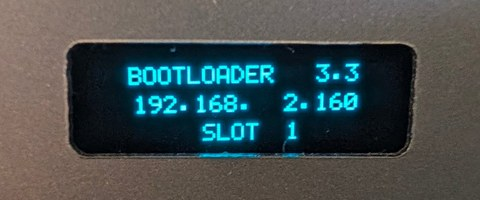

2. **Set the PC network** to the same subnet as the IP on the OLED, for example 192.168.2.10 / 255.255.255.0.
3. **Run BootLoader_3.3.** Enter the IP shown on the OLED and press **Connect**. The tool shows *Found: MAC …, bootloader 3.3*.
   - If you do not know the IP, press **Discover**. It finds the radio by broadcast, even in another subnet. Then either change the PC network, or set a new IP for the radio with **Change IP → Write IP**.

   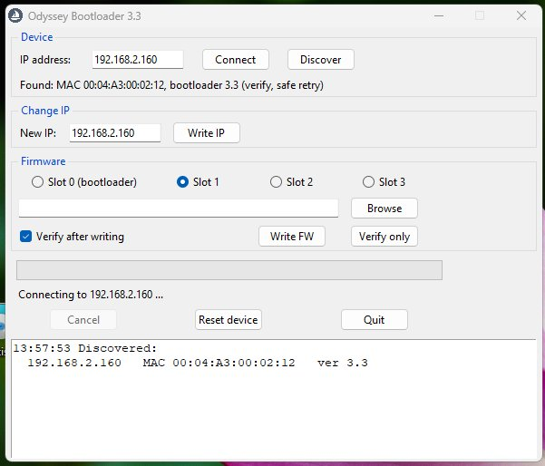

4. **Choose the slot** 1, 2 or 3. Press **Browse** and select `Odyssey.rbf`. Keep **Verify after writing** checked.
5. Press **Write FW**. The tool erases the slot (about 5 s), writes it and reads it back. The progress bar and log show each stage.
6. When asked *Reset the device now?*, answer **Yes**. The radio restarts and boots the slot shown on the OLED.

   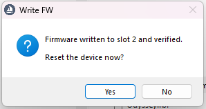

7. **To boot a different slot**, start in bootloader mode, choose the slot with **UP/DWN**, then press **MUTE**.

The slot you write in the PC tool and the slot the radio boots from are set separately. After writing a new slot, select it on the radio with UP/DWN.

### Changing the IP address

- **From the PC:** Connect or Discover, type the new address in **Change IP**, then press **Write IP**. Adjust the PC network and connect again.
- **From the microphone:** hold **P4** at power-on to restore 192.168.2.160, or **P3** to switch to DHCP (0.0.0.0).
- In DHCP mode the bootloader has no address of its own. Find the radio with **Discover** and give it a static IP with **Write IP**, or hold **P4** at power-on.

### Updating the bootloader itself (slot 0)

Select **Slot 0 (bootloader)** and a `Bootloader*.rbf` file, then press **Write FW** and confirm the warning.

> ⚠️ Do not interrupt power or the cable while slot 0 is being written. A damaged bootloader can only be restored with a JTAG programmer (USB-Blaster) and `Bootloader.pof`.

### MCU firmware

The front-panel controller firmware, `Odyssey_MCU.hex` in the `MCU_FW` folders, is written with a PIC programmer such as a PICkit. Only do this when a new version is released.

---

## Repository contents

| Folder | Content |
|---|---|
| `Odyssey_3_2.0_ANP` | Working firmware 2.0 (openHPSDR new protocol): `Odyssey.rbf`, Quartus sources, MCU firmware |
| `Odyssey_BL_3.3` | Bootloader 3.3: `.rbf` / `.pof` / `.sof`, sources, PC tool, MCU firmware |
| `PCB` | Main board and connection board (Sprint Layout 6 `.lay6`, Gerbers) |
| `Metalwork` | Front and rear panels, top cover, heatsink, copper plate, fan (DXF / SVG) |
| `BPF_ODY3`, `LPF_ODY_3` | Simulated responses of the band-pass and low-pass filters |
| `Misc` | Datasheets (KSZ9031, HR911130A, MGA-53543), SSM-75 pinout |
| `Images` | Photos and screenshots used in this page |

**Legend:** ANP = Angelia New Protocol, ported from the Angelia/Hermes openHPSDR firmware; BL = BootLoader.

---

73 de N7DDC
